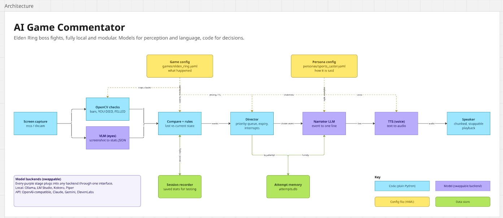

# Game Commentator

A real-time AI commentator for your own gameplay. It watches your game, works out what's happening, and narrates it out loud, like a sports caster calling a title fight. It reacts instantly to big moments and stays quiet when nothing is going on.

The first target is **Elden Ring boss fights**.

> **Status:** early setup. Only `main.py` exists so far; the structure below is the planned layout.

---

## What it does

- Detects which game you're playing and finds its window automatically, on any monitor
- Captures that window while you play
- Sends the newest frame to a **vision LLM** along with the game config (the list of events to look for and their priorities) and the previous game state
- The vision LLM reads the HUD and the scene (your HP, boss HP, "YOU DIED", "boss leaping into the air") and returns structured JSON: the current state plus **events with a priority**, such as `big_hit_landed`, `low_hp`, `you_died`, `boss_felled`
- Code validates that JSON against the game config and filters out repeats (e.g. "YOU DIED" staying on screen for several frames)
- Decides **when** to speak and **what** to talk about using a **priority stack**: one newest-first stack per priority level, so it always talks about the most important *and* most recent moment:
  - `filler` / `normal` events are dropped if something is already playing
  - `high` events wait on the stack and the newest is spoken next (the older ones are passed to the narrator as context)
  - `critical` events (death, boss felled) **interrupt** whatever is being said
  - every event has an expiry time, so stale reactions are never spoken, and each stack is capped so a busy fight can't pile up
- Writes a short commentary line with an LLM and speaks it with text-to-speech
- Remembers the current fight (deaths, the move that keeps hitting you, your weapon and the boss's) and the key moments of your play session (progress, closest calls, how you're doing), so lines build on each other: *"Attempt 23 on Malenia… boss at 18%, the furthest he's ever got!"*

## Outcome

- **Live, spoken commentary** on Elden Ring boss fights that feels responsive, not robotic
- **Runs fully local and free** on a consumer GPU alongside the game (developed on an RTX 4070 Ti); no API keys required
- **Modular by design**: three independent parts can be swapped without touching the engine:
  - **Game config**: how to recognise the game and which events to look for, with priorities (`config/games/*.yaml`)
  - **Persona**: how it talks: style, example lines, voice, chattiness (`config/personas/*.yaml`)
  - **Model backends**: local (Ollama, Kokoro, Piper) or API (OpenAI-compatible, Claude, Gemini, ElevenLabs)
- **Download and run**: a Windows app (.exe) that runs alongside the game, not a mod
- **Read-only**: it only looks at the game window and never sends inputs to the game

## How it works



```
Detect game ──► Window capture ──► Vision LLM ─────────────────────► Director ──► Narrator LLM ──► TTS ──► Speaker
                (newest frame)     (frame + game config + last state  (priority,    (event → line)  (voice)  (stoppable)
                                    → state + events with priority,    expiry,
                                    validated JSON)                    interrupts)
```

| Stage | Type | Job |
|---|---|---|
| Detection | Code | Work out which game is running and find its window |
| Window capture | Code | Grab the newest frame from the game window |
| Vision LLM | Model | Look at the frame with the game config and last state; return the current state and events with priorities as structured JSON |
| Validation | Code | Check the JSON against the config, drop unknown events and repeats, attach expiry times |
| Director | Code | Pick which event to narrate and when: priority stack (highest priority first, newest first within a level), expiry and interrupts |
| Narrator | Model | Write one short line in the persona's style |
| TTS | Model | Turn the line into speech |
| Speaker | Code | Play audio in chunks so it can be cut off for critical events |

**Design principle:** *models see and judge, code decides when to speak.* The vision LLM decides what happened and how important it is. Code keeps it honest (schema, known event types, de-duplication) and owns timing: the priority stack, expiry and interrupts.

### Why a priority stack

A caster should talk about **what just happened**. If several events of the same importance pile up while the commentator is still talking, a queue would pick the oldest (already stale); a stack picks the newest.

```
critical: [ ]
high:     [ took_heavy_damage, low_hp, big_hit_landed ← top ]   ← voice is free: take this one
normal:   [ healed ← top ]
filler:   [ scene_update ← top ]
```

- **One stack per priority level.** The director takes the top of the highest non-empty stack, so priority always beats recency.
- **Newest first within a level.** The older events in that stack go to the narrator as context, so one line can cover them: *"ON LOW HP he lands the big one!"*
- **Expired events are thrown away** whenever the director looks at a stack, and each stack keeps only its few newest events.

### What the vision LLM receives and returns

**In:** the newest frame (downscaled), the game config's event catalogue, and the previous state.

```yaml
# config/games/elden_ring.yaml (excerpt)
events:
  you_died:       { priority: critical, ttl: 5.0, look_for: "Large red 'YOU DIED' text in the centre of the screen" }
  boss_felled:    { priority: critical, ttl: 6.0, look_for: "Gold 'ENEMY FELLED' / 'GREAT ENEMY FELLED' text" }
  big_hit_landed: { priority: high,     ttl: 2.5, look_for: "Boss health bar drops sharply compared with the last state" }
  low_hp:         { priority: high,     ttl: 3.0, look_for: "Player's red health bar (top left) below about a quarter" }
  healed:         { priority: normal,   ttl: 3.0, look_for: "Player drinks a flask; health bar rises" }
```

**Out:** structured JSON, forced into a schema built from the config:

```json
{
  "state":  { "player_hp": 34, "boss_hp": 18, "boss_name": "Margit, the Fell Omen", "flasks": 1 },
  "events": [ { "type": "big_hit_landed", "priority": "high", "detail": "Charged greatsword hit, boss 27% to 18%" } ],
  "scene":  "Margit leaps into the air with a golden hammer while the player rolls away"
}
```

The vision LLM runs as fast as the model allows (about once a second on a 4070 Ti with a 3B model), always on the newest frame.

## Memory

Two kinds of memory make the commentary smarter than one-off reactions. Both live in memory while the app runs and are passed to the narrator as context; nothing is saved to disk.

**Fight memory (short-term):** live, reset for each boss fight.
- Who you're fighting, attempt number, deaths this session
- **What hit you:** the vision model describes the attack whenever you take a big hit, so it can call out repeats (*"The delayed slam. AGAIN."*)
- **Weapons:** yours (from the equipment icons) and the boss's (from the scene)
- Streaks and patterns, flasks, summons, phase, the boss's lowest HP this fight

**Session memory (longer-term):** a small rolling summary kept for the whole play session.
- **Progress this session:** bosses beaten and current region (read from the area-name banner)
- **Key moments:** closest calls, best attempts, the boss giving you the most trouble
- **Skill read:** attempts per boss, hits taken, whether you're improving or struggling
- **Habits:** the attack types that keep catching you, weapons used

It's kept small on purpose: a few counters plus a short list of important facts, with older or less important ones dropping off so it always fits in the narrator's context window. When a fight ends, fight memory is boiled down to a few lines and added here.

```
events ──► Fight memory (live) ──► summarised at fight end ──► Session memory (rolling summary)
                │                                                  │
                └──────────► Context builder ◄─────────────────────┘
                                   │  short, pre-summarised facts
                                   ▼
                              Narrator LLM
```

Code calculates the stats and a **context builder** turns them into a few short facts for the narrator, which keeps prompts small enough for local models. Each persona uses the same memory in its own way: the sports caster hypes the comeback, the dark narrator turns it into lore.

## How it runs

Game Commentator is a **Windows companion app** that runs alongside the game. It is not a mod: nothing is injected into the game, so it works with anti-cheat and isn't tied to one game.

- **Finds the game automatically.** Each game config says how to recognise its game (process name, window title). The app checks what's running, loads the matching config, and falls back to a generic vision-only mode for any other game. You can always pick the game or window manually.
- **Follows the game window, not the screen.** It captures only the game's window, so it works on any monitor, keeps up if the window moves, and pauses when you alt-tab. Frames are downscaled before the vision LLM sees them, so any resolution works.
- **One engine, several front ends.** The engine exposes simple controls (start, stop, mute, switch persona), and each way of running it just calls those:
  - **Command line**: `python main.py`, for development
  - **Tray app**: runs in the background with global hotkeys (hotkeys only listen; nothing is sent to the game)
  - **Subtitle overlay**: optional on-screen captions over the game
- **One-click installer.** The app is built with PyInstaller and wrapped in an Inno Setup installer that also installs [Ollama](https://ollama.com) if it's missing and can download the AI models during setup. Models live in Ollama, not inside the app, so it stays small and backends stay swappable.
- **First-run check.** On every start the app checks that Ollama is running and the models and voice files are present, and offers to download anything missing, or to switch to an API backend instead.

Play in **borderless windowed** mode for reliable capture and overlay support.

## Dev mode

```bash
python main.py --dev
```

Every stage reports what it's doing as a small structured event on an internal **event bus**. In dev mode, a **dev logger** writes all of them to one place, and a **dev dashboard** shows them live.

```
 capture ─┐
 vision ──┤                       ┌──► logs/<session>/events.jsonl   (everything, one file)
 director ┼──► Event bus ──► Dev logger
 narrator ┤                       └──► live stream ──► Dev dashboard (browser)
 voice ───┤
 memory ──┘
```

```json
{"t": 12.43, "stage": "director", "type": "event_dropped", "data": {"event": "healed", "reason": "expired"}}
```

- **One log per session:** `logs/<session>/events.jsonl` (JSON Lines), plus a sampled frame every few seconds so you can see what the model saw.
- **Dev dashboard:** a local web page that follows events live, or opens an old session log and replays it.
- **Replay for testing:** the vision LLM's recorded events replay through the director, narrator and voice offline, so tuning doesn't need the game running.
- **Zero cost when off:** without `--dev`, nothing is written.
- **Decoupled:** stages only publish events and don't know the dashboard exists, so it can change freely.

What the dashboard shows will be decided once real logs exist. Candidates: the frame the vision LLM saw next to the JSON it returned, HP graphs, an event timeline coloured by priority, the director's priority stacks with expiry countdowns, narrator prompts and responses, memory contents, and latency per stage.

## Tech stack

- **Python 3.12**
- **Game detection:** `psutil`, Win32 window APIs
- **Window capture:** `windows-capture` (Windows Graphics Capture), `mss` fallback
- **Vision:** vision LLM (Qwen2.5-VL / Gemma 3 / Moondream via Ollama) with structured JSON output
- **Language:** small local LLMs via Ollama, or any OpenAI-compatible API
- **Speech:** Kokoro / Piper
- **Config:** YAML
- **Packaging:** PyInstaller (one-folder) + Inno Setup installer
- **Releases:** GitHub Actions builds the installer from a version tag
- **Dev mode:** JSON Lines event log, local web dashboard (WebSocket)

## Project structure (planned)

```
Game-Commentor/
├── main.py                       # Entry point (command line)
├── commentator/                  # The engine: one folder per part
│   ├── core/                     # Shared types (GameEvent, Priority, ...), config loading, paths
│   ├── engine/                   # Runs the pipeline; start / stop / mute / switch persona
│   ├── detection/                # Which game is running + find its window
│   ├── capture/                  # Window capture
│   ├── vision/                   # Vision LLM: frame + game config + last state → state + events; validation, de-duplication
│   ├── director/                 # Priority stack, expiry, interrupts
│   ├── narrator/                 # LLM → commentary line
│   ├── voice/                    # TTS + stoppable playback
│   ├── memory/                   # Fight memory, session memory, context builder (all in RAM)
│   ├── backends/                 # Swappable model adapters (Ollama, OpenAI-compatible, Claude, Gemini, Kokoro, ...)
│   ├── events/                   # Event bus, event types, dev logger
│   └── ui/                       # Front ends: command line, tray app, subtitle overlay, dev dashboard
├── config/                       # Everything you can swap without touching code
│   ├── games/                    # How to recognise each game, which events to look for, priorities
│   │   ├── generic.yaml          # Works in any game
│   │   ├── elden_ring.yaml       # Process match, state fields, event catalogue
│   │   └── examples/             # Optional example frames shown to the vision LLM
│   ├── personas/                 # How the commentator talks
│   │   ├── sports_caster.yaml
│   │   └── dark_narrator.yaml
│   └── backends.yaml             # Which model runs each stage (local or API)
├── packaging/                    # PyInstaller spec + Inno Setup script (installer.iss)
├── .github/workflows/            # release.yml: version tag → build → installer → GitHub Release
├── experiments/                  # Throwaway spikes (e.g. vision model tests on screenshots)
├── tests/
├── docs/
│   ├── DESIGN.md                 # What and why: architecture, key decisions, principles
│   ├── IMPLEMENTATION.md         # Who builds what: tracks, contracts, tasks, milestones, status
│   └── architecture.png          # Architecture diagram
├── logs/                         # Dev-mode session logs (not committed)
├── .gitignore
└── README.md
```

- **`commentator/`**: each pipeline stage is its own folder (a Python package), so every part stays small and easy to find as the code grows.
- **`commentator/ui/`**: front ends only call the engine's controls, so the command line, tray app, overlay and dev dashboard share all the same logic.
- **`commentator/events/`**: every stage publishes what it does here; dev mode logs and streams it.
- **`config/`**: game, persona and backend files are plain YAML. Adding a game, a new commentary style or a different model means changing a file here, not writing code.
- **`docs/`**: short, focused docs so humans and AI agents can get context on one area without reading the whole codebase.

## Getting started

### Install (players)

Once releases are available:

1. Download `GameCommentatorSetup.exe` from the [Releases](https://github.com/Welsby/Game-Commentor/releases) page.
2. Run it. It installs the app and [Ollama](https://ollama.com) (if you don't already have it), and can download the AI models (~3–4 GB) for you.
3. Launch Game Commentator, start Elden Ring in **borderless windowed** mode, and fight a boss.

The installer isn't code-signed yet, so Windows may show "Windows protected your PC". Click **More info → Run anyway**.

### Run from source (developers)

Requires Python 3.12+.

```bash
git clone git@github.com:Welsby/Game-Commentor.git
cd Game-Commentor
python main.py
```

## Roadmap

The full plan, with tasks, owners and status, is in [docs/IMPLEMENTATION.md](docs/IMPLEMENTATION.md).

| Milestone | What works |
|---|---|
| **M0 Foundations** | Repo skeleton, shared types, event bus, CI |
| **M1 First words** | A recorded boss fight replays into in-character text commentary |
| **M2 Live text** | Live game → vision LLM → director → narrator, printed as text |
| **M3 It talks** | Spoken commentary with interrupts |
| **M4 Smart** | Fight and session memory; dev dashboard |
| **M5 v0.1.0** | Tray app, overlay, one-click installer on GitHub Releases |

**Stretch goals:** two casters (play-by-play + colour commentary), OBS browser source, auto-clipped highlights.

## Team

Built by **Welsby** and **Nathan**.

- **Welsby**: seeing and shipping. Game detection, window capture, the vision LLM stage, dev mode and dashboard, packaging, installer and releases.
- **Nathan**: thinking and speaking. Director, narrator and personas, text-to-speech, memory, engine controls, tray app and overlay.

